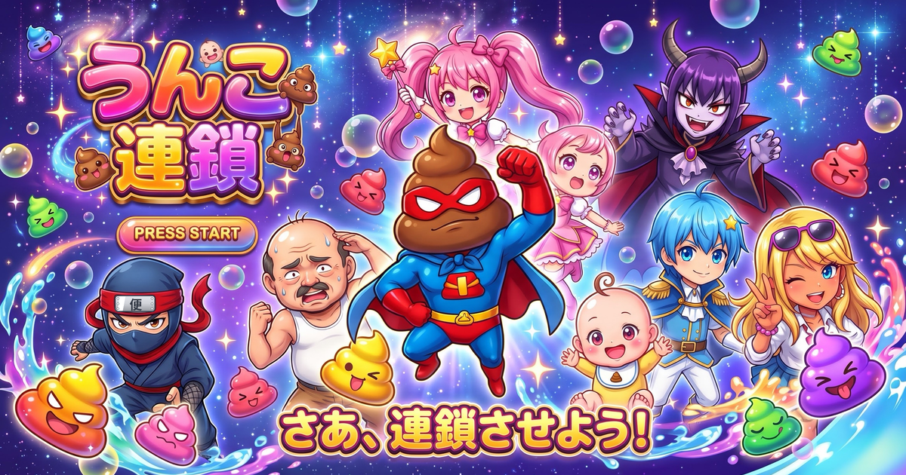

# うんこ連鎖オンライン

同じ色のうんこを4つ以上くっつけて流す、漫画風の落ちものパズルです。スマホで2人オンライン対戦できます。

## あそびかた

1. ニックネームを入れて、28人のキャラから選ぶ（勇者・魔法使い・女騎士・お姫さまなど。必殺技はキャラごとに違う）
2. 相手と同じ「ルーム名」を入れて「ルームに入る」
3. 2人とも「準備OK」を押すとスタート
4. 連鎖すると相手にカチカチうんこ（おじゃま）が降る

ひとりで練習もできます。CPU（よわい・ふつう・つよい・鬼）との3本先取の対戦もできます。

### 操作

- スマホ：画面下のボタン（◀ ▼ ▶ ↺ ↻）
- パソコン：← → 移動、↓ 落とす、Z・X（↑）回転

## アイテム・ハンデ

- **流す**：一番下の2段を流して消す（1試合2回）
- **金のうんこ**：となりで連鎖すると消えて、アイテムがもらえる（最大3個）
  - 下痢：おじゃまを下痢に変える。2手後に流れて消える
  - 紙：次の3手が同じ色のペアになる
  - 消臭：おじゃま予告を半分にする
  - 便秘：相手のNEXTを10秒間かくす（対戦のみ）
- **必殺技**：連鎖でゲージがたまり、満タンで使える。キャラごとに効果が違う（相手を3秒カチコチにする、画面をゆらす、など）
- **火事場のクソ力**：ピンチのときは攻撃が1.5倍
- **トイレ渋滞タイム**：2分たつと落下が最速＆攻撃2倍
- **3本先取**：先に3回勝ったほうがマッチ勝利。3連鎖以上でキャラのカットイン
- **スタンプ**：対戦中に「くさっ！」などを相手に送れる
- **ハンデ**：ダメージ半減・3色モード・落下ガイド・スピード固定。対戦では相手にお願いが届き、OKをもらえたときだけかかる

## ガチャ

- 遊ぶとコインがたまる（勝利・CPU戦・ひとり練習のスコア・毎日のログインボーナス）。最初は1000コイン
- 1回100コイン、10連900コイン（10回目はSR以上が確定）
- 当たるもの：キャラ20人＋シークレットキャラ4人（合計0.5%）・服装7種・持ち物10種。提供割合はゲーム内で確認できる
- 同じものが出たらコインに戻る（R=10・SR=50・SSR=200・シークレット=500）
- データはこの端末のブラウザに保存される（ブラウザのデータを消すと消える）

## プレゼント

- 保護者パスワードを知っている人だけが、コイン・キャラ・服装・持ち物を選んで「プレゼントコード／リンク」を作れる
- もらった人は、リンクをタップするか、コードを「プレゼント」画面にはりつけると、プレゼントBOXが開いて受けとれる
- コードは電子署名つき。書きかえたり、同じコードを2回使ったりはできない
- キャラを選んだ状態でもう一度タップすると、拡大表示と着せかえができる

## しくみ

- `index.html` 1枚だけで動きます（サーバー不要）
- オンライン対戦は無料の公開MQTTサーバー（EMQX / HiveMQ）を中継して通信します
